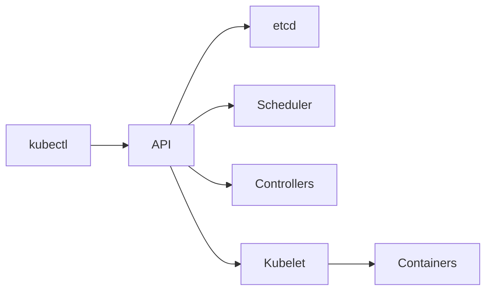

# Lab setup

Prerequisites: Linux, Git and a running Docker engine.(Should be similar to the K8s lab setup)

## Learning objectives

Explain the architecture, predict reconciliation behavior, deploy and inspect resources, diagnose one failure.

## The problem and how it works

A process needs a machine a reliable service needs a system that replaces failed processes. Kubernetes stores desired state in etcd through the API server. Controllers compare actual and desired state. The scheduler assigns unscheduled Pods to nodes kubelet asks the runtime to start containers and reports health. A Pod is the scheduling unit and shares networking among its containers. A Deployment maintains replicas through ReplicaSets.

kind runs each node as a Docker container, with containerd inside. The control-plane node runs API server, scheduler, controller manager and etcd. Its default taint excludes ordinary workloads. The two workers run application Pods. CoreDNS resolves Service names networking connects Pod IPs. A context selects cluster, credentials and default namespace. Namespaces scope names, not physical machines.

## Practical example

Follow [the student lab](lab.md), then compare with [instructor solutions](lab-solutions.md). All commands run from `golang-app/` unless a subshell changes directory.

## Common mistakes

Using the wrong context, applying files from the wrong directory, assuming Running means Ready, and treating a manual repair as a permanent Git change. Check `kubectl config current-context` before every mutation and inspect events before deleting failed Pods.

## Five conceptual review questions

1. What desired state does this module introduce?
2. Which component performs the work?
3. How do you distinguish successful configuration from successful operation?
4. Which change persists after reconciliation?
5. What evidence would you collect before deleting a failed resource?

## Further reading

- [Official technology documentation](https://kind.sigs.k8s.io/docs/user/quick-start/)
- [Kubernetes concepts](https://kubernetes.io/docs/concepts/)

## Installing prerequisites

On macOS install Docker Desktop from [Docker's installer](https://docs.docker.com/desktop/setup/install/mac-install/), launch it and wait for the engine. Homebrew users can install CLI tools with `brew install go kubectl kind fluxcd/tap/flux` this installs current versions, so use the release downloads below for the pinned classroom baseline.

On Linux install Docker Engine using [the distribution-specific instructions](https://docs.docker.com/engine/install/). Install the matching architecture archives from [Go downloads](https://go.dev/dl/), [kubectl installation](https://kubernetes.io/docs/tasks/tools/install-kubectl-linux/), [kind v0.27.0](https://github.com/kubernetes-sigs/kind/releases/tag/v0.27.0), and [Flux v2.5.1](https://github.com/fluxcd/flux2/releases/tag/v2.5.1). On Apple Silicon select arm64 on ordinary Intel/AMD hosts select amd64. Verify release checksums before installing executables into a PATH directory. Git and curl are also required. Flux is only needed in Module 04.

Check `go version`, `kubectl version --client`, `kind version`, `docker info` and `flux version --client`. Allow approximately 12 GB free disk space and outbound access to GitHub, Docker Hub and registry.k8s.io. Corporate proxies may need Docker daemon configuration as well as shell configuration. If cluster creation fails, inspect `kind export logs /tmp/course-kind-logs --name course` do not troubleshoot by modifying another Kubernetes context.
