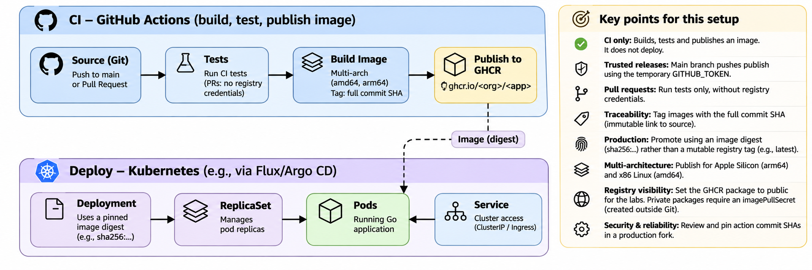

# Application, containers and CI

Prerequisites: Module 00 complete so we have a runing kind cluster

## Learning objectives

Explain the architecture, predict reconciliation behavior, deploy and inspect resources, diagnose one failure, and justify the recovery using observed evidence.

## The problem and how it works

An application binary alone does not describe how to run, route or update a service. Go supplies the HTTP server a multi-stage build keeps the compiler out of the runtime image. Our scratch image contains only a static binary and runs as UID 65532.

The application reads MESSAGE and ADDR. VERSION is injected at build time. JSON logs go to stdout SIGTERM stops accepting requests and drains active requests for up to ten seconds. Liveness detects a stuck process readiness removes unready Pods from Service endpoints without restarting them. Requests influence scheduling CPU limits throttle and memory limits can cause OOM kills.

A Deployment controls ReplicaSets and rolling replacement. The Service selects app=go-app and maps port 80 to named container port http (8080). Port-forward binds localhost and works on Linux and macOS without cloud load balancers. Ingress describes HTTP routing but requires an installed ingress controller merely applying an Ingress creates no proxy. We use port-forward for the required labs.

The pipeline uses the same scripts locally and in STACKIT Git Actions:

- `scripts/build-app.sh` runs Go tests and builds the container image. The Dockerfile compiles the Go application.
- `scripts/push-source.sh` pushes committed source to the current `main` or `kaloyan-app` branch of an existing STACKIT Git repository, triggering CI. Run this locally.
- `scripts/push-dockerhub.sh` logs in, tags the built image, and pushes it to `<Docker Hub username>/course-app`.

Set the STACKIT Git repository secrets `DOCKERHUB_USER` and `DOCKERHUB_TOKEN` before pushing. CI runs the build script for pull requests and pushes to `main` or `kaloyan-app`; only main pushes run the publish script. CI tags images with `sha-<full commit SHA>`. Local defaults are `course-app:v1` and `VERSION=v1`; override `IMAGE`, `IMAGE_TAG`, and `VERSION` to use another tag. Each image targets the build machine's architecture (check the selected runner architecture). CI does not deploy to Kubernetes.

Complete [STACKIT CI setup](../STACKIT-CI.md), then follow [the instructor commands](instructor-commands.md) to run each step.

## Practical example

`k8s/kustomization.yaml` simply lists the Deployment and Service to apply together. Run `kubectl -n course-app apply -k 01-app-ci/k8s` to apply both. No generators or overlays are needed here; the app defaults to the message `Hello students`.

Follow [the student lab](lab.md), then compare with [instructor solutions](lab-solutions.md). All commands run from `golang-app/` unless a subshell changes directory.

## Five review questions

1. What desired state does this module introduce?
2. Which component performs the work?
3. How do you distinguish successful configuration from successful operation?
4. Which change persists after reconciliation?
5. What evidence would you collect before deleting a failed resource?

## Further reading

- [Official technology documentation](https://kubernetes.io/docs/concepts/workloads/controllers/deployment/)
- [Kubernetes concepts](https://kubernetes.io/docs/concepts/)
