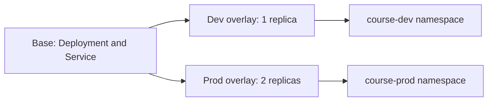

# Kustomize: one application, two environments

**Time:** 30 minutes including the demo. **Prerequisite:** Module 01 completed with `course-app:v1` loaded into kind.

## The idea

Imagine you want one application Pod for development and two for production. You could copy every YAML file, but then every common change needs editing twice.

**Kustomize reuses a base and applies a small set of environment changes.** The base is ordinary Kubernetes YAML. An overlay says what should differ. Kustomize is already available through kubectl; no extra installation is needed.

## What you will learn

Identify a base and an overlay, preview the final YAML, and deploy the same application with different replica counts.



## Read just these three files first

1. `base/deployment.yaml`: the application definition you already know.
2. `base/kustomization.yaml`: lists the shared resources.
3. `overlays/dev/kustomization.yaml`: lists the base and the changes for dev.

The important part of the dev overlay is:

```yaml
resources: [../../base, namespace.yaml]
namespace: course-dev
replicas:
- name: go-app
  count: 1
```

Read this as: “Use the shared base, put it in course-dev, and set the go-app Deployment to one replica.” Production uses the same base but sets two replicas and a different namespace. Namespace files create the namespaces; namespaces keep identically named resources separate.

The existing overlays also set MESSAGE through a ConfigMap and select an image tag. Leave these unchanged for this short demo. They are used by the later GitOps modules. Generated ConfigMap names have content hashes; a configuration change updates the Pod template reference and triggers a rollout. You do not need to memorize that mechanism to understand bases and overlays.

## Two commands to remember

```bash
# Preview: prints ordinary YAML without changing the cluster.
kubectl kustomize 02-gitops-config-kustomize/overlays/dev

# Deploy: renders the overlay and submits it to Kubernetes.
kubectl apply -k 02-gitops-config-kustomize/overlays/dev
```

Kustomize prepares configuration. Kubernetes controllers maintain the requested Deployment after it is applied. Changing a local file alone does not change the cluster: run apply, or later let a GitOps controller apply the committed change.

## Common mistakes

- Using `apply -f` on the build file: use `apply -k` on the directory.
- Editing the base to make a dev-only change: edit the dev overlay instead.
- Thinking preview deploys anything: `kubectl kustomize` only renders.
- Storing credentials in values or ConfigMaps: do not put real credentials in Git. Kubernetes Secret encoding is not encryption.

## Five review questions

1. What belongs in the base?
2. What belongs in an overlay?
3. Why do we use separate namespaces?
4. What is the difference between preview and apply?
5. Does changing dev's replica count change production?

Start [the short demo](lab.md). [Instructor answers](lab-solutions.md) explain the results. Image updates, rollback and broken-path diagnosis are preserved in the optional [extended lab](extended-lab.md) and [extended solutions](extended-lab-solutions.md).

Further reading: [official Kustomize guide](https://kubernetes.io/docs/tasks/manage-kubernetes-objects/kustomization/).
