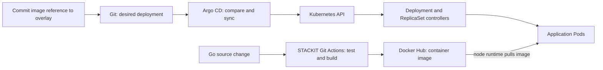
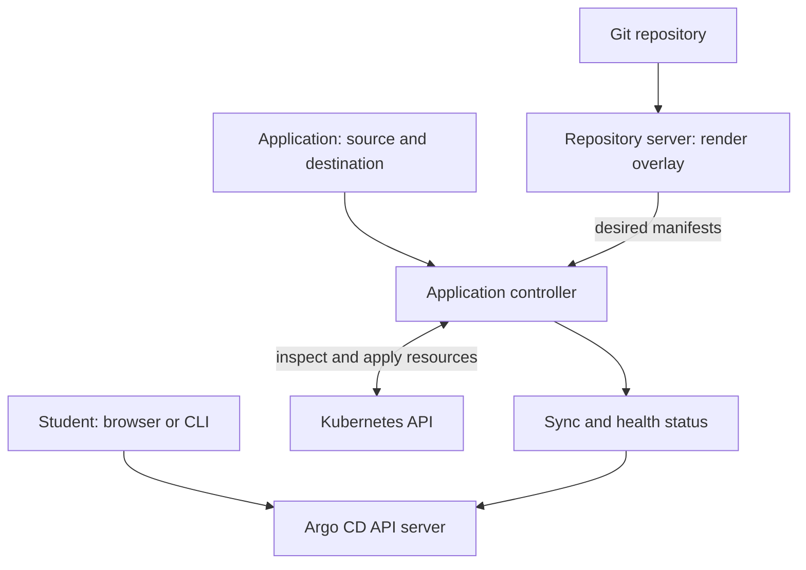
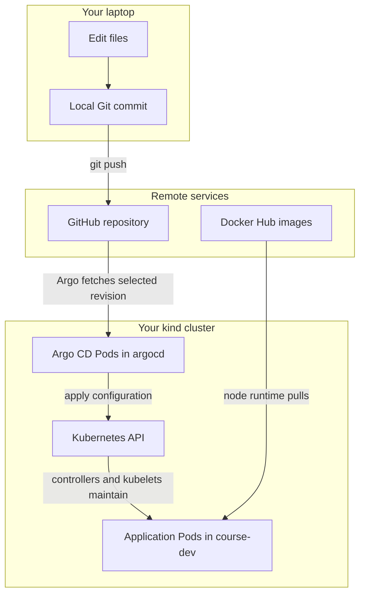
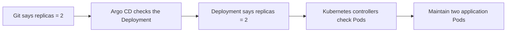
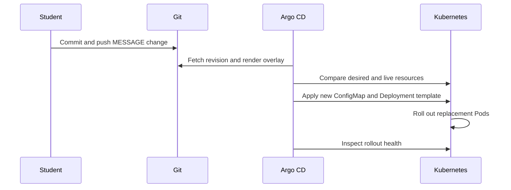
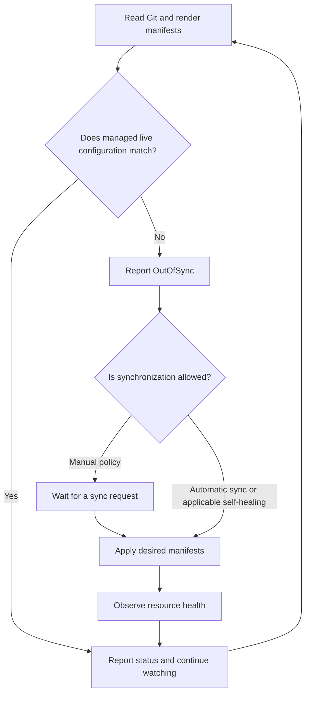
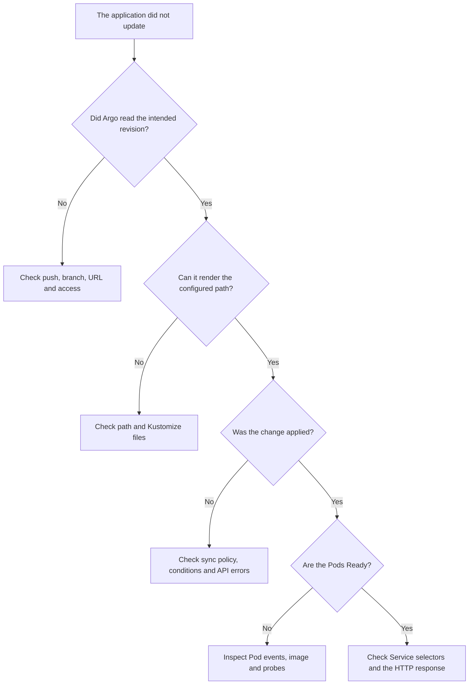

# GitOps with Argo CD

**Prerequisites:** Module 02 complete, the course cluster running. Run commands from `golang-app/` using context `kind-course`.

## What you will learn

- Explain how Git changes become Kubernetes changes.
- Identify what Argo CD does and what Kubernetes still does.
- Read an Application and distinguish sync status from health.
- Predict automatic synchronization, self-healing and pruning.
- Diagnose a failed deployment and recover through Git.

## Before we start: six words in everyday language

| Word          | Meaning                                                   | Example in our course                            |
| ------------- | --------------------------------------------------------- | ------------------------------------------------ |
| Desired state | What you want the system to look like.                    | The Deployment should run two replicas.          |
| Live state    | What Kubernetes currently reports.                        | The Deployment currently requests four replicas. |
| Manifest      | A YAML description of a Kubernetes object.                | A Deployment or Service file.                    |
| Render        | Turn configuration into the final manifests.              | Combine a Kustomize base and overlay.            |
| Reconcile     | Check for differences and work toward the desired result. | Restore replicas from four to two.               |
| Revision      | A particular version of the files in Git.                 | A commit identified by its SHA.                  |

A controller is a program that runs continuously and responds to changes. Think of a thermostat: you choose the target temperature, it measures the room, and it acts when the measurements differ. GitOps uses configuration in Git as its target. The analogy has a limit: it cannot decide whether your target is sensible. If Git asks for an image that does not exist, the controller needs you to correct that request.

Read the diagrams as **who talks to whom** or **what happens next**, according to their captions. Arrows do not mean everything happens instantly.

## 1. The problem: who keeps the cluster correct?

In Module 02 you ran `kubectl apply -k ...`. That works, but somebody must remember to run it after each configuration change. Someone can also change the cluster manually, leaving the files and cluster different.

For example, Git says **one replica**, but a person scales the Deployment to **four**. Which value should the next engineer trust?

GitOps makes Git the recorded desired state. A controller repeatedly compares that state with the cluster and can correct differences. This repeated check-and-correct process is called **reconciliation**.

**Argo CD is that controller, together with an application dashboard and management API.** It reads deployment configuration from Git and applies it to Kubernetes. It does not compile Go or build container images.

## 2. Where CI ends and Argo CD begins



There are two separate changes: publishing an image and choosing to deploy that image. Our workflow publishes `sha-<commit>` tags. You then update the overlay's image reference and push that configuration change. **Publishing a new image alone does not update this course's deployment.**

In push delivery, a CI job connects to the cluster and runs deployment commands. In this pull workflow, Argo CD reads Git from inside the cluster. The course CI job therefore needs registry publishing permission, but no cluster credentials.

## 3. The main components

| Component                      | Simple explanation                                                                            |
| ------------------------------ | --------------------------------------------------------------------------------------------- |
| Application resource           | Instructions describing what to deploy and where.                                             |
| Repository server              | Fetches repository content and renders tools such as Kustomize into Kubernetes manifests.     |
| Application controller         | Compares desired and live resources, performs synchronization, and assesses status.           |
| Argo CD API server             | Provides the API used by the UI and CLI, including authentication and application operations. |
| Kubernetes API and controllers | Store the submitted resources and make Deployments, ReplicaSets and Pods behave accordingly.  |



Argo CD does not start containers itself. After it applies a Deployment, Kubernetes controllers maintain the ReplicaSet and Pods; the scheduler chooses nodes and kubelets run the containers. See the [official architecture](https://argo-cd.readthedocs.io/en/stable/operator-manual/architecture/).

### What runs on your laptop, on GitHub, and in the cluster?



_Location diagram: the GitHub repository is outside kind; Argo CD and your application run inside kind. The controller fetches Git even after you close your editor._

An uncommitted file is visible only on your laptop. A local commit is also invisible to Argo until it is pushed to the configured remote branch. Closing the browser dashboard does not stop reconciliation. If Argo itself is unavailable, existing application Pods can keep running under Kubernetes, but Argo cannot apply new Git changes until it recovers.

### Who repairs what?

There are two cooperating control loops:



_Responsibility diagram: Argo maintains the configuration of managed objects; Kubernetes maintains the workloads described by those objects._

If you delete one Pod, its ReplicaSet creates a replacement even without Argo. If you manually change the Deployment to four replicas, Kubernetes faithfully tries to run four; Argo self-healing then restores the Deployment's Git value of two. Kubernetes cannot infer what your Git file said by itself.

## 4. Mini example: read the Application

An **Application** is a custom Kubernetes resource. Installing Argo CD registers its resource type through a CustomResourceDefinition, or CRD.

This shortened example illustrates the important fields; the complete file is [manifests/application.yaml](manifests/application.yaml):

```yaml
spec:
  source:
    repoURL: https://YOUR-GIT-HOST/OWNER/REPO.git
    targetRevision: kaloyan-app
    path: 02-gitops-config-kustomize/overlays/dev
  destination:
    server: https://kubernetes.default.svc
    namespace: course-dev
  syncPolicy:
    automated:
      prune: true
      selfHeal: true
```

Read it as: “Read this repository's `kaloyan-app` branch, build the dev overlay, and deploy it to this cluster.” The destination URL is the Kubernetes API inside the cluster. The overlay already sets `course-dev` on its namespaced resources.

The Application object itself lives in `argocd`; the application workloads live in `course-dev`. These namespaces have different responsibilities.

Follow the [lecturer instructions](lecturer-instructions.md) to install Argo CD, connect your private Git repository, and select the custom branch. Replace the repository URL and configure the public Docker Hub image as instructed in [the lab](lab.md). After installation and configuration:

```bash
kubectl apply -f 03-argoCD/manifests/application.yaml
kubectl -n argocd get applications
kubectl -n course-dev get deployment,pods,service
```

The first command registers the instructions. It does not mean the deployment has already finished; use the next commands to inspect progress.

### Can the configuration stay in the same repository as the code?

Yes. A separate GitOps repository is optional. For example:

```text
my-project/
├── api/
├── frontend/
└── deployment/
    ├── kustomize/
    │   ├── base/
    │   └── overlays/demo/
    └── gitops/
```

If my-project is the repository root, the application source path would be `deployment/kustomize/overlays/demo`. In this course, `golang-app/` is the repository root, so paths start with module directories such as `02-gitops-config-kustomize/` or `05-capstone/`. Never use your laptop's absolute filesystem path.

The GitOps configuration file tells the controller which application folder to render. Keep the application folder focused on the resources you want it to manage. A public repository can be fetched without repository credentials; a private one needs controller access configured separately from image-pull access.

## 5. Follow one change from Git to a Pod

Suppose you change the dev overlay's `MESSAGE` from `Hello dev` to `Hello university`.



Kustomize generates a new ConfigMap name because its contents changed. It updates the Deployment's ConfigMap reference too. That changes the Pod template, so Kubernetes rolls out new Pods with the new environment variable. Existing processes do not automatically reread changed environment variables.

Commit and push only the intended file:

```bash
git add 02-gitops-config-kustomize/overlays/dev/kustomization.yaml
git commit -m "Change development greeting"
git push
kubectl -n argocd get application course -w
```

Reconciliation is asynchronous. A push need not appear in the cluster immediately. Stop the watch with Ctrl+C after observing the new state.

## 6. Sync and health answer different questions

| Question                                  | Status                                           | Example                                               |
| ----------------------------------------- | ------------------------------------------------ | ----------------------------------------------------- |
| Does the live configuration match Git?    | `Synced` or `OutOfSync`                          | Live replicas differ from the rendered overlay.       |
| Are the resources operating successfully? | `Healthy`, `Progressing`, `Degraded`, and others | A Deployment is waiting for new Pods to become ready. |

A Deployment using a nonexistent image can be **Synced**: the image field matches Git exactly. It can still be **Progressing**, and eventually **Degraded**, because the new Pods cannot become available. Status timing depends on the resource's health assessment. These are separate dimensions in [Argo CD's core concepts](https://argo-cd.readthedocs.io/en/stable/core_concepts/).

```bash
kubectl -n argocd get application course -o yaml
kubectl -n course-dev describe deployment go-app
kubectl -n course-dev describe pods -l app=go-app
```

Inspect the Application for source or rendering errors; inspect Pods and events for image, scheduling or probe failures.

## 7. Three automation settings, three different effects

- **Automatic sync:** applies a new desired configuration from Git without requiring a person to click Sync.
- **Self-healing:** restores managed live configuration that someone changed outside Git.
- **Pruning:** removes tracked resources that are no longer in the desired configuration.

For example, while Git says one replica:

```bash
kubectl -n course-dev scale deployment/go-app --replicas=4
kubectl -n course-dev get deployment/go-app -w
```

With self-healing enabled, Argo restores one replica. To make four permanent, change the overlay's replica count, commit and push. A live repair can be temporary; a Git repair changes the desired state.

Pruning is deletion, not just tidying a dashboard. Removing a managed Namespace from Git can delete everything inside it. Review removals before syncing. See [automatic synchronization behavior](https://argo-cd.readthedocs.io/en/stable/user-guide/auto_sync/).

### Walk around the reconciliation loop



_Simplified decision diagram: comparison, synchronization and health assessment are different activities. Retry rules and configured exclusions can affect the exact behavior._

Here is an illustrative drift trace. These are stages, not measured timings or a promise of an exact polling period:

| Stage                   | Git replica count | Live Deployment replica count | Explanation                              |
| ----------------------- | ----------------: | ----------------------------: | ---------------------------------------- |
| A: stable               |                 1 |                             1 | Configuration agrees.                    |
| B: manual scale         |                 1 |                             4 | A person changes the live object.        |
| C: self-heal            |                 1 |                             1 | Argo restores the desired field.         |
| D: scale-down completes |                 1 |                             1 | Kubernetes finishes removing extra Pods. |

The live replica **setting** and the number of **Ready Pods** are different measurements. At stage C, extra Pods can still be terminating. That is why checking only a YAML field is not enough to establish application health.

### A small debugging decision tree



_Diagnosis diagram: start at the earliest failed stage. Rebuilding an image will not repair an incorrect Git path._

## 8. Recovery and the next module

For a bad committed configuration, revert the offending commit and push the correction. Argo then reconciles the corrected state. A manual `kubectl rollout undo` alone does not fix Git and can be reversed by self-healing.

Keep the administrative UI on localhost through port-forwarding. Do not publish its initial password in your submissions.

Our Application has no cascading deletion finalizer. The lab deletes the Application before the Flux module, leaving the dev workloads running but unmanaged. This is intentional: deleting the management object and deleting the application workloads are different operations. Do not add a resource deletion finalizer during this handoff.

## Common mistakes

- Pushing Go source and expecting a deployment before promoting its image reference.
- Including a `golang-app/` prefix in a GitOps path when that directory is already the Git repository root.
- Confusing the `argocd` management namespace with `course-dev`.
- Treating Synced as proof that requests succeed.
- Editing the live cluster repeatedly while self-healing restores Git values.

## Five conceptual review questions

1. What does STACKIT Git Actions do that Argo CD does not do in this course?
2. Which component renders Kustomize, and which compares live resources?
3. How can an Application be Synced while its new Pods cannot start?
4. How do automatic sync, self-healing and pruning differ?
5. Why should a permanent rollback change Git rather than only the live Deployment?

## Practical work and further reading

Continue with [the student lab](lab.md); use [instructor solutions](lab-solutions.md) after attempting it.

- [Application specification](https://argo-cd.readthedocs.io/en/stable/user-guide/application-specification/)
- [Resource health](https://argo-cd.readthedocs.io/en/stable/operator-manual/health/)
- [Deletion and finalizers](https://argo-cd.readthedocs.io/en/stable/user-guide/app_deletion/)
