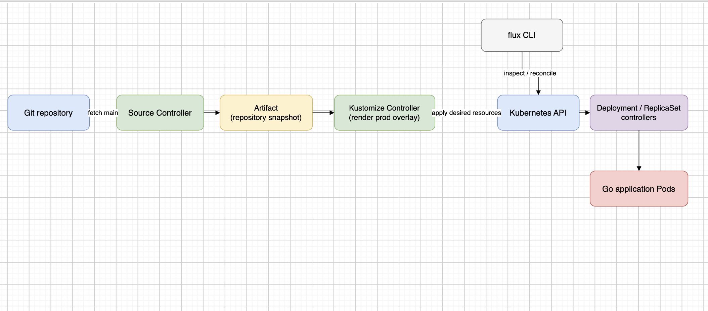
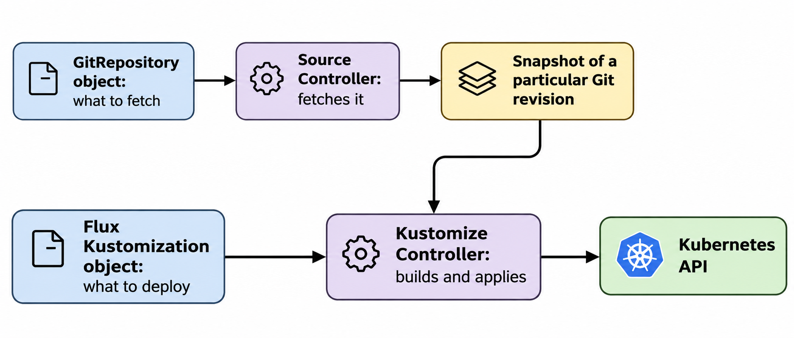
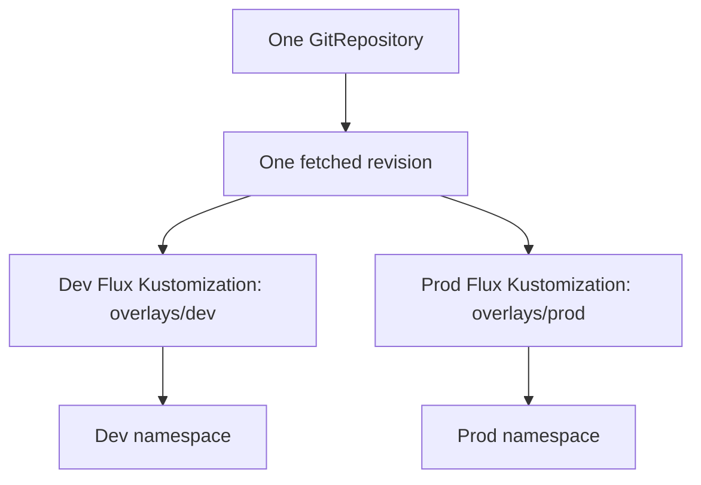
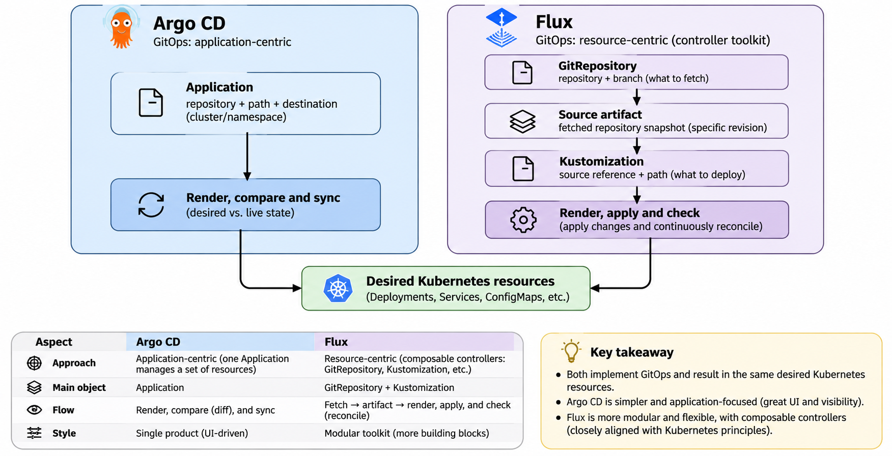
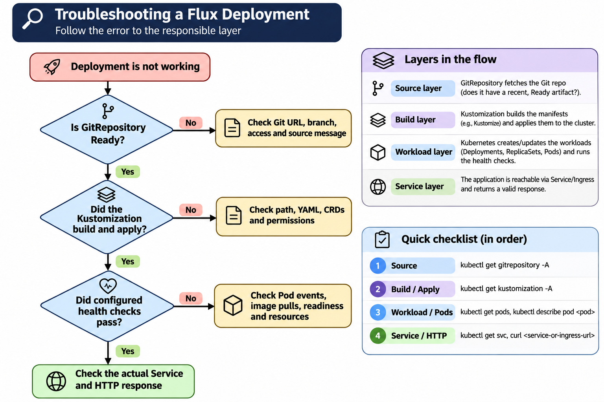

# GitOps with Flux CD

**Prerequisites:** Module 03 complete, the course cluster running, your public course repository, and Flux CLI 2.5.1 installed. Commands run from `golang-app/` using context `kind-course`.

## What you will learn

- Explain how Flux fetches Git and applies an overlay.
- Distinguish GitRepository, Flux Kustomization and a Kustomize build file.
- Inspect and request reconciliation using the CLI.
- Compare Flux and Argo CD without confusing their shared GitOps principles.
- Transfer management safely and diagnose a failed reconciliation.

## Before we start: six words in everyday language

| Word          | Meaning                                                   | Example in our course                            |
| ------------- | --------------------------------------------------------- | ------------------------------------------------ |
| Desired state | What you want the system to look like.                    | The Deployment should run two replicas.          |
| Live state    | What Kubernetes currently reports.                        | The Deployment currently requests four replicas. |
| Manifest      | A YAML description of a Kubernetes object.                | A Deployment or Service file.                    |
| Render        | Turn configuration into the final manifests.              | Combine a Kustomize base and overlay.            |
| Reconcile     | Check for differences and work toward the desired result. | Restore replicas from four to two.               |
| Revision      | A particular version of the files in Git.                 | A commit identified by its SHA.                  |

A controller is a program that runs continuously and responds to changes. Think of a thermostat: you choose the target temperature, it measures the room, and it acts when the measurements differ. GitOps uses configuration in Git as its target. The analogy has a limit: it cannot decide whether your target is sensible. If Git asks for an image that does not exist, the controller needs you to correct that request.

Read the diagrams as **who talks to whom** or **what happens next**, according to their captions.

## 1. The problem is the same the organization is different

You still want Git to describe what should run and a controller to keep Kubernetes consistent with it. Flux implements this through cooperating controllers, each responsible for a particular job.

For this course, think of two instructions:

1. **Get these files:** a `GitRepository` identifies the repository and branch.
2. **Deploy this folder:** a Flux `Kustomization` identifies an overlay inside those files.

These are Kubernetes resources. Installing Flux registers their types and starts the controllers that act on them. The Flux CLI helps you create and inspect instructions the controllers continue working after you close the terminal.

## 2. How the pieces work together



An **artifact** here is a stored snapshot of the fetched repository content at a particular revision. It is not the application's container image. The node's container runtime still pulls the application's image from GHCR when starting a Pod.

| Controller              | Responsibility                                                                           | Used in this lab?              |
| ----------------------- | ---------------------------------------------------------------------------------------- | ------------------------------ |
| Source Controller       | Retrieves Git and other supported sources and exposes their artifacts.                   | Yes                            |
| Kustomize Controller    | Renders manifests, applies them, corrects drift and checks configured health conditions. | Yes                            |
| Helm Controller         | Manages Helm releases through HelmRelease resources.                                     | No                             |
| Notification Controller | Handles configured event notifications and webhook receivers.                            | No configuration required here |
| Image controllers       | Optional image discovery and automation that can update Git according to policy.         |                                |

This separation lets several deployments use a shared source. The wider toolkit is described in the [Flux component reference](https://fluxcd.io/flux/components/).

### The instructions are not the workers

A GitRepository object is stored in the Kubernetes API. It is a description, not a running Git process. Source Controller is the program that reads that description and does the fetching. The same relationship holds between a Flux Kustomization object and Kustomize Controller.


_Object-to-controller diagram: a resource describes the job a controller performs it._

Imagine a teaching assistant receiving two cards: “Download the main branch of this repository” and “Use the production folder from that download.” Flux keeps checking those instructions. Closing the terminal does not erase the cards or stop its controllers.

If Flux is temporarily unavailable, Kubernetes still maintains existing Deployments. Flux must recover before it can fetch and apply new desired state. A failed application Pod is normally replaced by its ReplicaSet, not by the Flux CLI.

## 3. Mini example: where should Flux get the files?

The complete [manifests/source.yaml](manifests/source.yaml) contains:

```yaml
apiVersion: source.toolkit.fluxcd.io/v1
kind: GitRepository
metadata:
  name: course
  namespace: flux-system
spec:
  interval: 1m
  url: https://github.com/REPLACE_OWNER/REPLACE_REPO.git
  ref:
    branch: main
```

Read this as: “Check this repository's main branch every minute.” Replace the owner and repository placeholders before applying it.

`metadata.name: course` names the Kubernetes object. It does not create a new repository on GitHub. A successful fetch produces an artifact with a revision that other controllers can use. Read the detailed [GitRepository documentation](https://fluxcd.io/flux/components/source/gitrepositories/).

## 4. Mini example: which files should be deployed?

The complete [manifests/kustomization.yaml](manifests/kustomization.yaml) contains:

```yaml
apiVersion: kustomize.toolkit.fluxcd.io/v1
kind: Kustomization
metadata:
  name: course
  namespace: flux-system
spec:
  interval: 1m
  timeout: 3m
  path: ./golang-app/02-gitops-config-kustomize/overlays/prod
  sourceRef:
    kind: GitRepository
    name: course
  prune: true
  wait: true
```

The `sourceRef` connects this instruction to the previous object in the same namespace. The `path` is relative to the fetched repository root. The prod overlay places workloads in `course-prod` the Flux management objects live in `flux-system`.

`interval` controls recurring reconciliation. Source revision changes can also trigger work, so it is not simply a fixed two-minute pipeline. `wait: true` requests health checks for the applied resources, with `timeout` limiting how long an operation waits. `prune: true` enables removal of previously managed resources absent from the desired set.

### Two things named Kustomization

|                 | Kustomize build configuration                                     | Flux Kustomization resource                                 |
| --------------- | ----------------------------------------------------------------- | ----------------------------------------------------------- |
| API group       | `kustomize.config.k8s.io/v1beta1`                                 | `kustomize.toolkit.fluxcd.io/v1`                            |
| Course location | `02-gitops-config-kustomize/overlays/prod/kustomization.yaml`     | `04-fluxCD/manifests/kustomization.yaml`                    |
| Meaning         | How to combine a base, replicas, image changes and configuration. | Where and when Flux should build and reconcile those files. |
| How used        | `kubectl kustomize` or a renderer reads the file.                 | `kubectl apply -f` creates an object watched by Flux.       |

The filename alone does not tell you which one it is. Read `apiVersion`. You do not deploy the Kustomize build file as a Kubernetes custom resource. See the [Flux FAQ](https://fluxcd.io/flux/faq/).

### Can the configuration stay in the same repository as the code?

Yes. A separate GitOps repository is optional. For example:

```text
my-project/
├── api/
├── frontend/
└── deployment/
    ├── kustomize/
    │   ├── base/
    │   └── overlays/demo/
    └── gitops/
```

If my-project is the repository root, the application source path would be `deployment/kustomize/overlays/demo`. In this course repository the full path includes `golang-app/...` because that folder is inside the repository. Never use your laptop's absolute filesystem path.

The GitOps configuration file tells the controller which application folder to render. Keep the application folder focused on the resources you want it to manage. A public repository can be fetched without repository credentials a private one needs controller access configured separately from image-pull access.

### Why split fetching from deploying?

A single repository snapshot can be useful to more than one deployment:



_Illustrative reuse diagram: different Flux Kustomizations can select different folders from the same source. The required lab creates only the production Kustomization._

Separate deployments can have different intervals, health checks and permissions. Sharing a source does not mean every directory in it is automatically deployed. The selected path determines what is built resources referenced by that build determine what is applied.

## 5. Follow a change through reconciliation

Suppose production currently runs two replicas, and you commit a change to three:

```yaml
# Fragment of the prod overlay's Kustomize build file
replicas:
  - name: go-app
    count: 3
```

After the lab has installed Flux and registered both resources, you can request an immediate reconciliation instead of waiting for the normal interval:

```bash
flux reconcile kustomization course --with-source
flux get sources git
flux get kustomizations
kubectl -n course-prod get deployment,pods
```

`--with-source` also requests that the source be reconciled. The command does not build a Go binary or push an image. For an application release, CI must first publish the image and your configuration must reference that published version.

If somebody runs the following while Git still says two replicas, Flux restores the managed replica field on reconciliation:

```bash
kubectl -n course-prod scale deployment/go-app --replicas=4
flux reconcile kustomization course
kubectl -n course-prod get deployment/go-app
```

The correction is not necessarily instantaneous. Workloads also need time to scale or roll out after the desired object is applied. See [Kustomization reconciliation](https://fluxcd.io/flux/components/kustomize/kustomizations/).

### Mini exercise: predict before checking

Assume the production overlay in remote Git still specifies two replicas. After Module 04 installation:

```bash
kubectl -n course-prod scale deployment/go-app --replicas=4
flux reconcile kustomization course
kubectl -n course-prod get deployment go-app
```

Predict which count will remain ?

## 6. How Flux differs from Argo CD

**Both are pull-based GitOps tools.** Both can read Git, deploy Kustomize configuration, correct drift and delete resources through pruning. Both require permissions to manage their target resources. Neither replaces Kubernetes scheduling or container execution.

The main difference for this course is how they organize and expose that work:

| Topic                  | Argo CD                                                                                    | Flux                                                                                                                       |
| ---------------------- | ------------------------------------------------------------------------------------------ | -------------------------------------------------------------------------------------------------------------------------- |
| Main configuration     | An Application connects source, path, destination and sync policy.                         | A GitRepository supplies content a Kustomization selects and reconciles a path.                                            |
| Architecture           | Application-oriented controller with repository server and management API.                 | Cooperating controllers organized by responsibilities such as source, Kustomize and Helm.                                  |
| User experience        | Bundled web UI displays applications, diffs, resource trees and health CLI also available. | Core toolkit is operated through Kubernetes resources and CLI dashboards are available through ecosystem integrations.     |
| Status in this lab     | Application sync status and health status.                                                 | Source and Kustomization conditions, messages and revisions.                                                               |
| Applying changes       | Automatic sync must be configured manual sync is also available.                           | An active Kustomization reconciles automatically according to its configuration.                                           |
| Repairing live edits   | Enable self-healing for automatic restoration.                                             | Recurring Kustomization reconciliation corrects drift in managed configuration unless behavior is suspended or overridden. |
| Starting a check early | Refresh compares state sync applies desired state.                                         | `flux reconcile ...` requests controller reconciliation `--with-source` includes the source.                               |
| Helm approach          | Argo typically renders Helm charts and manages the resulting resources as an Application.  | Helm Controller manages Helm releases through HelmRelease resources.                                                       |
| Image updates          | Separate image automation tooling is needed beyond the basic deployment workflow.          | Optional image controllers provide policy-based Git updates they are not enabled by these lab manifests.                   |
| Course target          | Development overlay in `course-dev`.                                                       | Production overlay in `course-prod`.                                                                                       |

These differences follow the [Argo CD architecture](https://argo-cd.readthedocs.io/en/stable/operator-manual/architecture/) and [Flux components](https://fluxcd.io/flux/components/). They do not mean Argo requires clicking through a UI or Flux cannot have a dashboard: both can be configured declaratively in Git.

### The same instruction expressed two ways



## 7. Diagnose the stage that failed

A source being Ready does not prove the application works.

| Observation                                            | Likely stage       | What to inspect                                               |
| ------------------------------------------------------ | ------------------ | ------------------------------------------------------------- |
| GitRepository is not Ready                             | Fetching           | Repository URL, branch, authentication and network access.    |
| Source is Ready Kustomization reports path/build error | Rendering          | Repository-relative path and overlay resources.               |
| Kustomization reports API rejection                    | Applying           | API versions, installed CRDs, permissions and invalid fields. |
| Resources applied but readiness fails                  | Workload operation | Pod events, image availability, probes and capacity.          |

```bash
flux get sources git
flux get kustomizations
kubectl -n flux-system describe gitrepository course
kubectl -n flux-system describe kustomization course
flux logs --level=error
kubectl -n course-prod describe pods -l app=go-app
```

For example, `path: ./missing` can leave the source Ready because Git was fetched correctly. Rendering then fails, and existing application Pods normally continue running. Fix the Flux path and reconcile again. A nonexistent image tag is a different failure: rendering can succeed, but new Pods cannot start.

### Follow an error to the responsible layer



_Diagnosis diagram: each layer provides different evidence. A Ready source means the files were retrieved, not that your application's behavior was tested._

For example, a wrong Service selector can leave application Pods healthy but prevent requests reaching them. Neither tool's high-level status replaces checking the user's actual request path.

## 8. Cleanup

Before this lab, follow Module 03's cleanup: delete its Application, which has no cascading deletion finalizer. Dev workloads remain. Flux targets prod, so the two modules also use separate resource sets.

Do not point both controllers at the same Deployment. Even if their current values agree, a later change can make them continually undo each other's work.

Our Flux Kustomization has pruning enabled. Before deleting it while retaining workloads, follow the lab's explicit `prune: false` procedure. Removing management leaves objects running deleting `course-prod` removes its contents. Removing a Namespace from a pruned desired set can also destroy unrelated objects inside that namespace, so review such changes carefully.

## Common mistakes

- Applying an ordinary Kustomize build file as though it were a Flux resource.
- Treating a fetched artifact as a container image.
- Checking only source readiness and missing an apply or health error.
- Expecting a CLI command to fix an incorrect Git configuration permanently.
- Assuming Flux image promotion happens automatically without image automation configuration.
- Letting Flux and Argo CD manage the same resources.

## Five review questions

1. What jobs do Source Controller and Kustomize Controller perform?
2. How is a Flux Kustomization different from the overlay's Kustomization file?
3. Why can GitRepository be Ready while application deployment fails?
4. Name two differences between Flux and Argo CD, and two behaviors they share.
5. What happens to a manually changed replica count, and how would you make the change permanent?

## Practical work and further reading

Continue with [the student lab](lab.md) use [instructor solutions](lab-solutions.md) after your attempt.

- [Getting started with Flux](https://fluxcd.io/flux/get-started/)
- [Flux Helm releases](https://fluxcd.io/flux/components/helm/helmreleases/)
- [Flux image automation](https://fluxcd.io/flux/guides/image-update/)
- [Argo CD Helm integration](https://argo-cd.readthedocs.io/en/stable/user-guide/helm/)
