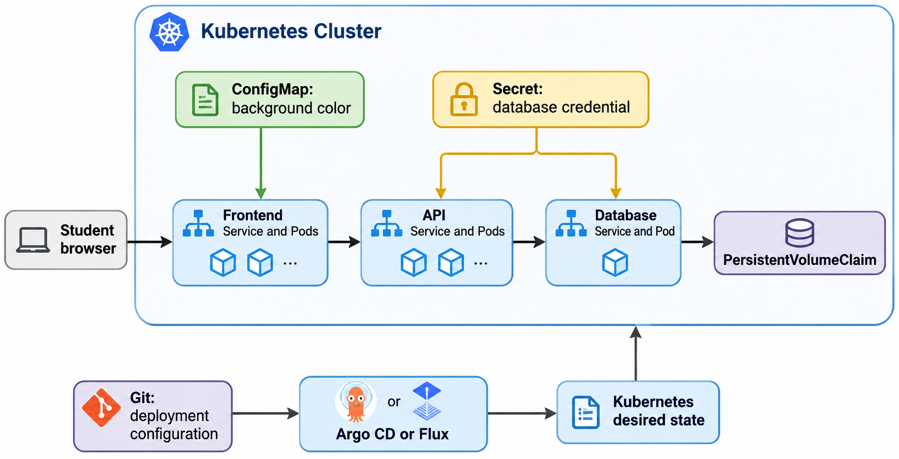

# Final project: Campus Board on your own Kubernetes cluster

**Scenario:** Your university needs a small shared noticeboard. Students open a webpage, submit a short note and see saved notes after refreshing. You are responsible for implementing the application and operating it on Kubernetes.

Build **three tiers**: a frontend, a Go HTTP API and a database. Package them using **Helm or Kustomize**, then manage that deployment using **Argo CD or Flux CD** on your own three-node kind cluster.

The browser must communicate through the frontend's public entry point. Internal names such as `api` and `db` resolve inside Kubernetes, not on a student's laptop. A frontend reverse proxy is a simple way to route browser `/api/` requests to the internal API Service.

## Your deliverable

A working application another student can clone, build and deploy without private instructor infrastructure. Demonstrate saving data, changing the page color through a ConfigMap, deploying a new version, and recovering from drift and one deliberate failure.

Read [requirements](requirements.md), follow the [project milestones](lab.md), and check the [100-point rubric](evaluation.md). Choose one packaging tool and one GitOps controller; you do not need to implement all four combinations.

## Time and prerequisites

Prerequisites: the application, configuration, GitOps and Helm modules. Allow a two-hour supervised project kickoff/demo plus **4–6 hours of independent work**. Teams of two may share implementation, but each student must explain the request path and demonstrate one operational change.

## Student and instructor separation

Student-facing work is described here and in requirements.md, lab.md and evaluation.md. The complete reference implementation and a runnable demo are in [instructor-solutions/](instructor-solutions/README.md). Attempt the design and implementation before opening that solution. A copy without an explanation is not a completed capstone.
