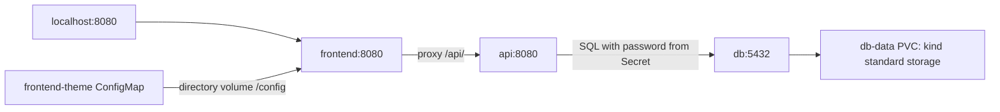

# Instructor solution: Campus Board

A complete reference implementation for the final project. Start with [START.md](docs/START.md), then use [DEMO.md](docs/DEMO.md) for the classroom presentation and [GITOPS.md](docs/GITOPS.md) to choose Argo CD or Flux. [VALIDATION.md](docs/VALIDATION.md) distinguishes checks executed during authoring from those you must run on your machine.

## Simple project layout

```text
instructor-solutions/
├── frontend/                 # main.go, frontend.go, static/index.html, Dockerfile
├── api/                      # main.go, api.go, postgres.go, Dockerfile
├── deployment/
│   ├── kind-config.yaml      # your three-node capstone cluster
│   ├── kustomize/            # base plus demo overlay
│   ├── gitops/               # Argo or Flux configuration
│   ├── helm/                 # alternative packaging route
│   └── rendered/             # preserved demo snapshot; not GitOps input
├── scripts/                  # build/load, Secret creation, smoke test
├── docs/                     # startup, presentation, GitOps and validation guides
└── README.md
```

Each service is an independent, small Go module with its own Dockerfile. Run tests from api/ or frontend/. There is no shared app/ directory or hidden build context. The tiny server.go in each service provides graceful HTTP shutdown so either service can be built on its own.

**For your existing test cluster:** this is a source-layout refactor. Resource names, images, namespace and data remain the same. Your yellow ConfigMap setting was preserved. No cluster reset is needed. If GitOps is already active, follow [the path migration instructions](docs/GITOPS.md#updating-an-existing-installation-after-this-refactor).

## What is implemented

- `api/`: Go API using PostgreSQL through the pinned lib/pq driver.
- `frontend/`: Go static web server and reverse proxy; the browser never needs cluster DNS.
- `frontend/static/`: one-page note form and list, using textContent to display user text.
- `deployment/kustomize/`: all resources and a small demo overlay.
- `deployment/helm/campus-board/`: an alternative chart for the same resources.
- `deployment/gitops/`: four alternative integrations; choose **one**, not all.
- `scripts/`: transparent build/load, Secret creation and HTTP smoke-test commands.
- Root `.forgejo/workflows/capstone-ci.yaml`: tests and publishes both application images.

The database Secret and namespace are created separately. Both packaging alternatives assume one installation per namespace: names api, frontend, db, db-data and frontend-theme are intentionally fixed for teaching clarity. Do not install Helm over an existing Kustomize deployment. Use a fresh disposable cluster/namespace when comparing packaging routes.



## Design decisions to explain

The frontend serves `/config` by reading `/config/BACKGROUND_COLOR` on every request. Its JavaScript polls every five seconds. The ConfigMap is mounted as an entire directory, **without subPath**, allowing kubelet to refresh projected files. Expect eventual propagation, often tens of seconds and sometimes around two minutes, rather than immediate visibility. No image rebuild or rollout is required. See [Kubernetes ConfigMap update behavior](https://kubernetes.io/docs/concepts/configuration/configmap/).

API liveness checks the process; readiness checks the database. SQL calls have timeouts and parameterized insertion. The API retries initial table creation before serving and has a generous startup probe. Two API replicas share PostgreSQL. The database's persistent volume survives ordinary Pod replacement; kind's local storage does not survive deletion of the cluster and is not highly available.

A single classroom PostgreSQL role performs both initialization and application queries. The official image creates this role with elevated database privileges. A production deployment should use separate migration and restricted runtime roles, backups, TLS, managed credential rotation and maintained image versions. The pinned images are classroom reproducibility baselines. The note board has no authentication and must stay on localhost. No sensitive data belongs in demo notes.

## Reference answers to student questions

**Q1.** api is a Kubernetes Service name, resolvable within the cluster. The browser uses localhost and the frontend proxies /api/ to the Service.

**Q2.** Color and non-sensitive host/database names are configuration. Passwords and tokens belong in Secrets or an external secret system and must not be committed. Secret base64 encoding alone is not encryption.

**Q3.** The replacement db-0 mounts db-data and reads the same records. Deleting its PVC may remove the backing local volume; deleting the kind cluster destroys its local data. Retention is not a backup.

**Q4.** Inspect Argo Application status.sync.revision or Flux source and reconciliation status. Fetching can succeed while rendering, API validation, image pulls or readiness fail.

**Q5.** This implementation rereads the mounted file and polls /config; wait for kubelet's volume update plus the browser poll. An environment-based design instead requires an explicit rollout.

**Q6.** GitOps restores desired Git configuration. A live-only repair can be overwritten on the next reconciliation, whereas a committed repair is repeatable and reviewable.
